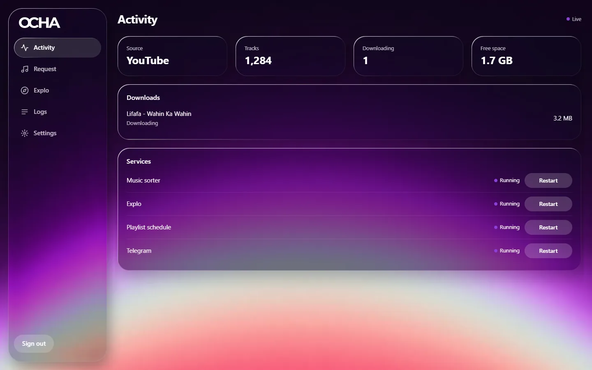
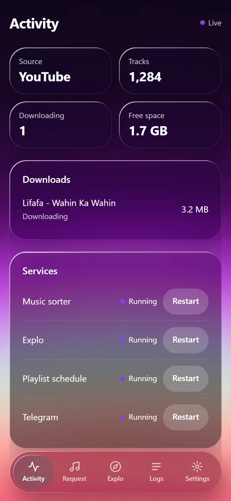
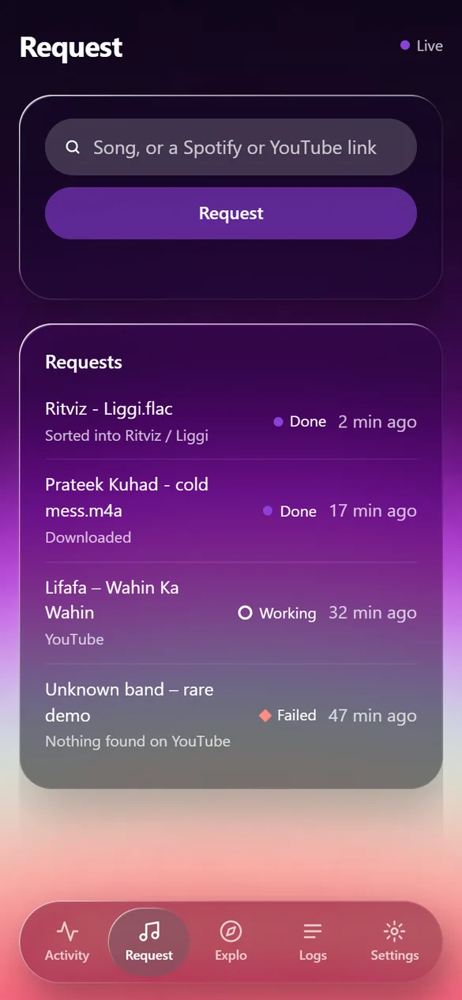
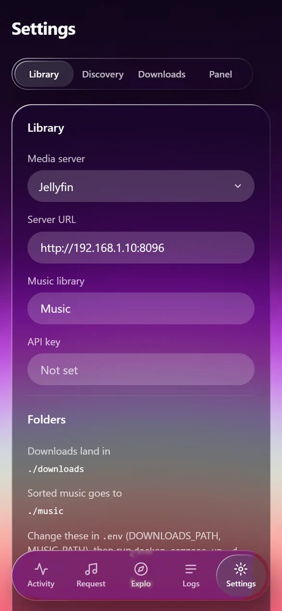
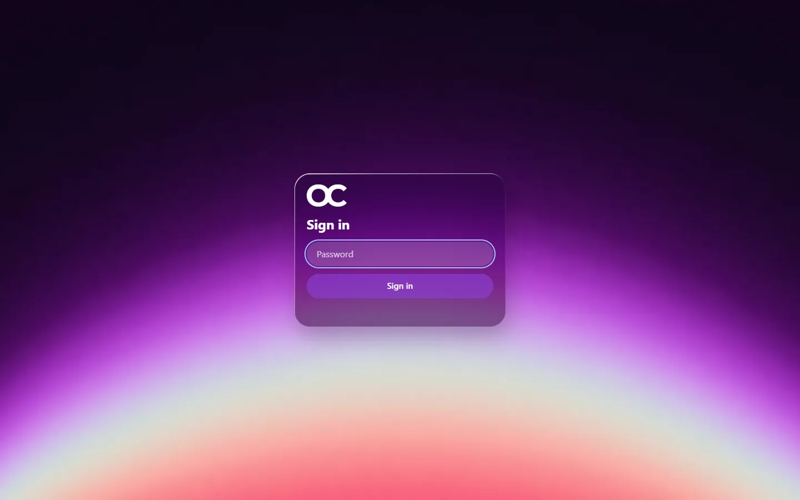
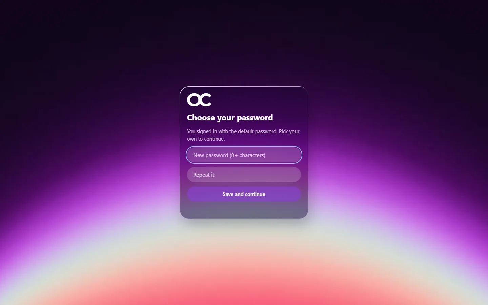
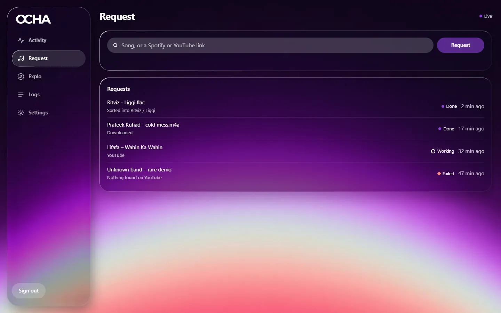
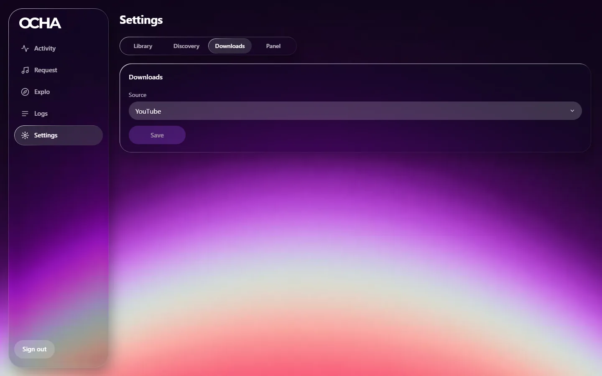
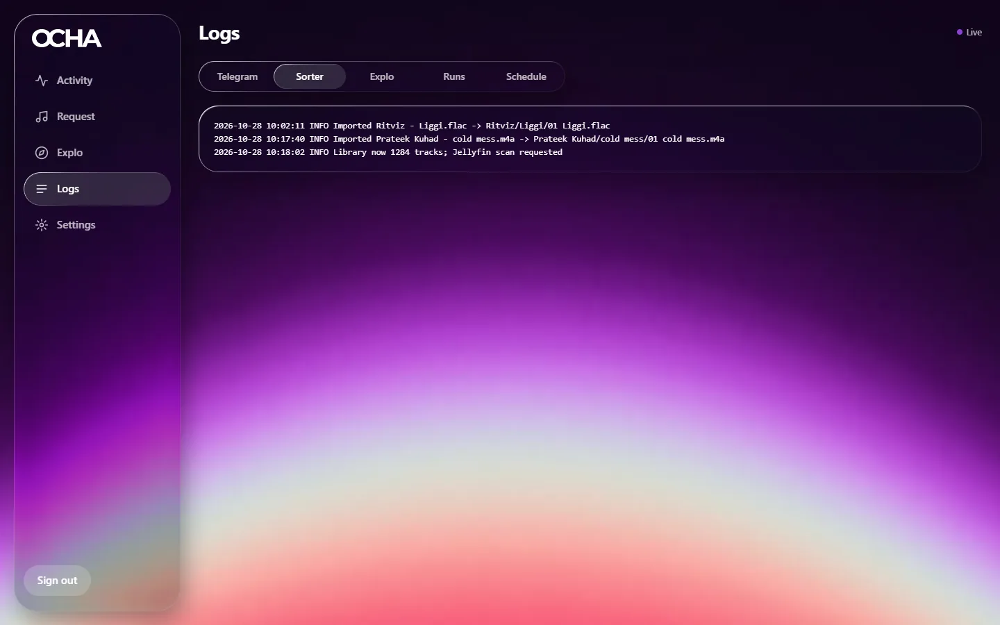

<h1><picture>
  <source media="(prefers-color-scheme: dark)" srcset="control_panel/static/brand/ocha-wordmark.png">
  
</picture></h1>

**OCHA keeps your own music library full of the music you're discovering.**

It watches your discovery playlists (ListenBrainz "Weekly Exploration", Spotify, Apple Music), finds the tracks you don't have yet, downloads them, tags and files them neatly with Beets and MusicBrainz, and builds the same playlists on your **Jellyfin** or **Navidrome** server. You can also ask for any single song from a web panel that works on your phone.

Everything runs in **one Docker container** behind **one password-protected control panel**.



<p align="center">
  
  
  
</p>

---

## What it does

| | |
|---|---|
| 🔎 **Finds what's missing** | Explo compares each playlist against your library, tolerant of `(radio edit)`, `From "Movie"`, transliteration and featured-artist spellings. |
| ⬇️ **Downloads it** | From YouTube (yt-dlp, the default), Soulseek (slskd) or a Telegram music bot. Switch any time in Settings. |
| 🏷️ **Files it properly** | A Beets watcher tags every file from MusicBrainz and moves it to `Artist/Album/Track`. Collabs stay under the main artist, and duplicates never loop. |
| 📻 **Builds the playlist** | Explo rescans Jellyfin or Navidrome and creates or updates the playlist in place. |
| 🎵 **Takes requests** | Type `Artist – Song` or paste a Spotify or YouTube link in the panel. |
| ⏰ **Runs on schedule** | Set a schedule per playlist in the Explo dashboard. OCHA runs them one at a time. |
| 📱 **Works on your phone** | Installable web app with a bottom tab bar, large tap targets, and live status. |

```
ListenBrainz / Spotify / Apple Music playlists
                 │
                 ▼
   Explo ── what's missing from your library?
                 │
                 ▼
   Downloader ── YouTube (yt-dlp) · Soulseek (slskd) · Telegram music bot
                 │  files land in /downloads
                 ▼
   Music sorter ── Beets + MusicBrainz tags, Artist/Album/Track
                 │  files land in /music
                 ▼
   Jellyfin / Navidrome ── rescanned, playlist built

   Control panel (port 8090) ── settings, requests, live status, logs,
                                and the Explo dashboard, behind one login
```

---

## Quick start

You need [Docker with Compose](https://docs.docker.com/get-docker/) and a Jellyfin or Navidrome server.

```bash
git clone https://github.com/sekiro65/ocha.git
cd ocha
cp .env.example .env
docker compose up -d
```

Open **`http://<your-server-ip>:8090`** and sign in with the default password **`Melovepassword`**. OCHA immediately asks you to choose your own password; nothing else works until you do.

Then follow the **[setup walkthrough](docs/setup-guide.md)**, which takes about 15 minutes.

| Screen | |
|---|---|
|  |  |
| Sign in with the default password… | …and OCHA makes you replace it. |

---

## Documentation

| Guide | What's in it |
|---|---|
| **[Setup walkthrough](docs/setup-guide.md)** | Install, first sign-in, every setting explained, your first request, playlists and schedules, phone install |
| **[Connecting other services](docs/connect-services.md)** | Where to get each key: Jellyfin, Navidrome, ListenBrainz, Spotify, slskd, YouTube cookies, plus running behind a domain (Caddy, nginx, Cloudflare Tunnel) |
| **[Telegram downloader](docs/telegram-userbot.md)** | Using a Telegram music bot as the download source: API ID, sign-in, rate limits |
| **[Security](SECURITY.md)** | What's protected and how, the hardening done after two security audits, and how to report a problem |

---

## Screens

| Activity | Request |
|---|---|
|  |  |
| Library size, live downloads, and every service with a restart button. | Ask for a song, then watch it download and get sorted. |

| Settings | Logs |
|---|---|
|  |  |
| One tab per area, each with its own Save. Fields appear only when they apply. | Live logs for every service, in one place. |

---

## Configuration at a glance

Only a few things live in `.env`. Everything else is set in the panel and stored in `config/settings.env`.

| `.env` key | Default | What it's for |
|---|---|---|
| `UI_PORT` / `EXPLO_PROXY_PORT` | `8090` / `8091` | Panel and Explo dashboard ports |
| `UI_PASSWORD` | `Melovepassword` | First password. You must change it on first sign-in. |
| `MUSIC_PATH` | `./music` | Your sorted library. Point Jellyfin or Navidrome here, or reuse the folder they already scan. |
| `DOWNLOADS_PATH` | `./downloads` | Where downloads land before sorting |
| `CONFIG_PATH` | `./config` | Settings, databases, Telegram session, logs |
| `PUID` / `PGID` | `1000` | The user that owns your music. OCHA never runs as root. |
| `UI_PUBLIC_URL` / `EXPLO_PUBLIC_URL` | unset | Your HTTPS addresses when OCHA is behind a domain |
| `ALLOWED_HOSTS` | unset | Extra hostnames you open the panel on. IPs, `localhost`, `.local` and `.lan` already work. |
| `TRUSTED_IP_HEADER` | unset | For example `CF-Connecting-IP` behind Cloudflare, so rate limiting sees real visitor IPs |

```
ocha/
├── docker-compose.yml   # the ocha container (+ optional slskd)
├── Dockerfile           # builds Explo (Go) and the Python runtime
├── .env.example         # ports, first password, folders
├── entrypoint.sh        # first-run setup, then drops root
├── supervisord.conf     # runs the five services
├── control_panel/       # web panel, Explo proxy, playlist scheduler
├── explo/               # Explo, with the Telegram downloader and matcher fixes
├── telegram_bot/        # Telegram userbot with a local HTTP API
└── music_sorter/        # Beets watcher, config and the artistnorm plugin
```

---

## Artists and albums in Jellyfin

The `artistnorm` Beets plugin keeps collaborations from splitting into separate artists:

- `ALBUMARTIST` is the primary artist only (`Aastha Gill feat. Badshah` → `Aastha Gill`), and files go under that artist's folder.
- `ARTISTS` (multi-value) lists every credited artist, so each collaborator still links to the track.
- Singles get one folder each (`Artist/<Title>/Title.flac`), because Jellyfin treats each folder as one album.

**Required Jellyfin setting:** Dashboard → Libraries → Music → enable **"Prefer non-standard artists tag"**, then rescan.

Band names with `&`, `and`, `/`, `,` or `x` in them (for example `AC/DC`) go in `music_sorter/beets-plugins/artist-exceptions.txt`. To fix an existing library, run `beet normartists -n` (preview), `beet normartists`, then `beet move`.

---

## Troubleshooting

| Problem | Fix |
|---|---|
| Forgot the panel password | Delete `config/ui/auth.json` and restart. The `.env` password works again, and you'll be asked to change it if it's still the default. |
| YouTube says "Sign in to confirm you're not a bot" | Common on VPS IPs. Add `config/cookies.txt` from a spare Google account ([how](docs/connect-services.md#youtube-cookies-only-if-youtube-blocks-you)). |
| "Unknown host" (421) | You opened the panel on a hostname OCHA doesn't know. Add it to `ALLOWED_HOSTS` or `UI_PUBLIC_URL` in `.env`. |
| A service shows *Failed* | Open **Logs** for that service, then press **Restart** on Activity. |
| Tracks downloaded but not in a playlist | Check the Jellyfin library name in Settings → Library, and that the music folder is the one Jellyfin scans. |

---

## License and credits

MIT (see [`LICENSE`](LICENSE)). OCHA includes third-party code under its own licences:

- **[Explo](https://github.com/LumePart/Explo)** by Markus Kuuse, MIT, modified (`explo/`, see `explo/LICENSE` and `explo/NOTICE`).
- **Parallel file transfer** from mautrix-telegram by Tulir Asokan, MIT (`telegram_bot/fast_telethon.py`).

Only download music you have the right to. OCHA doesn't host, index or link to any copyrighted content. Use third-party APIs within their terms of service.
